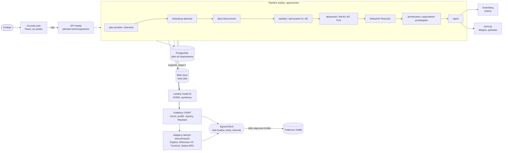
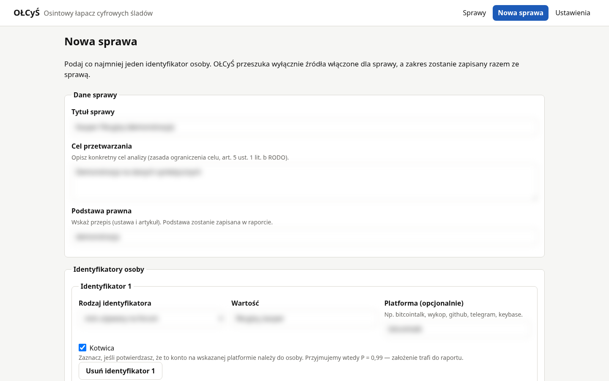
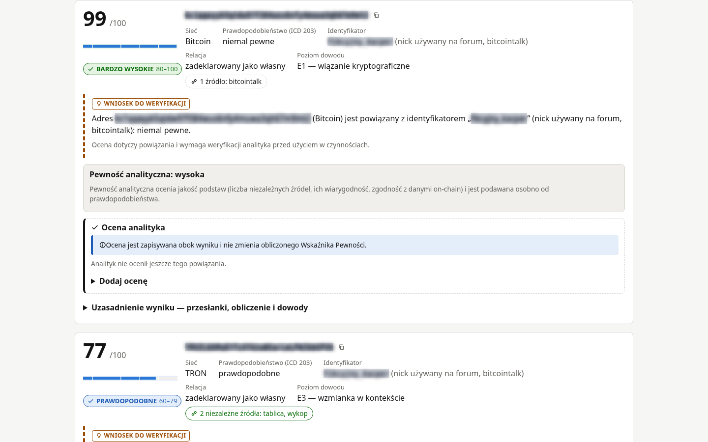
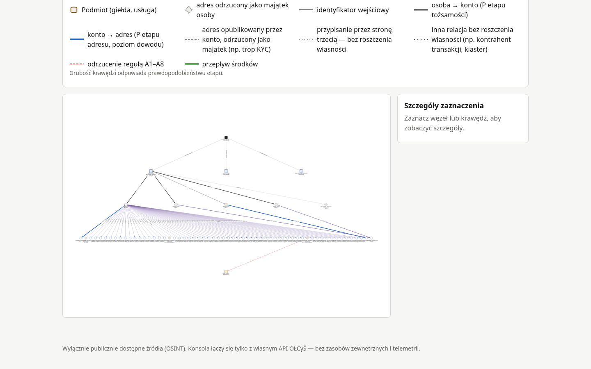
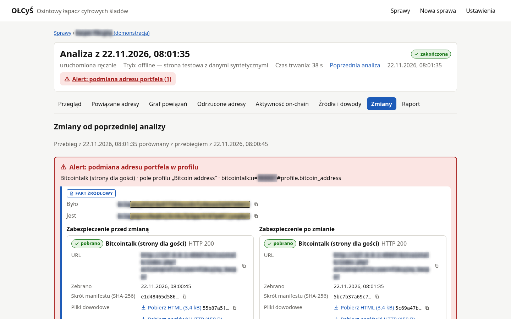
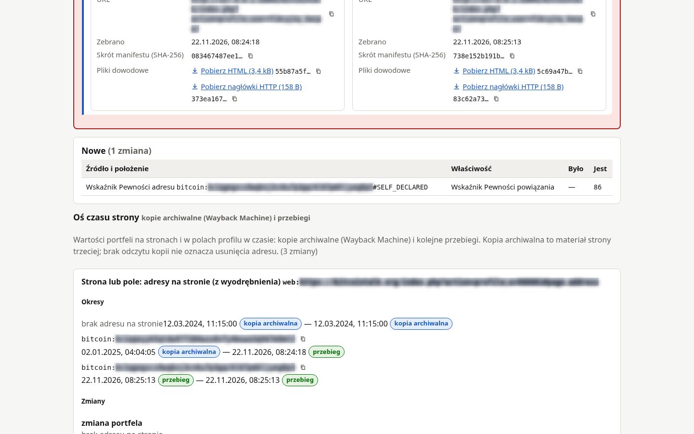
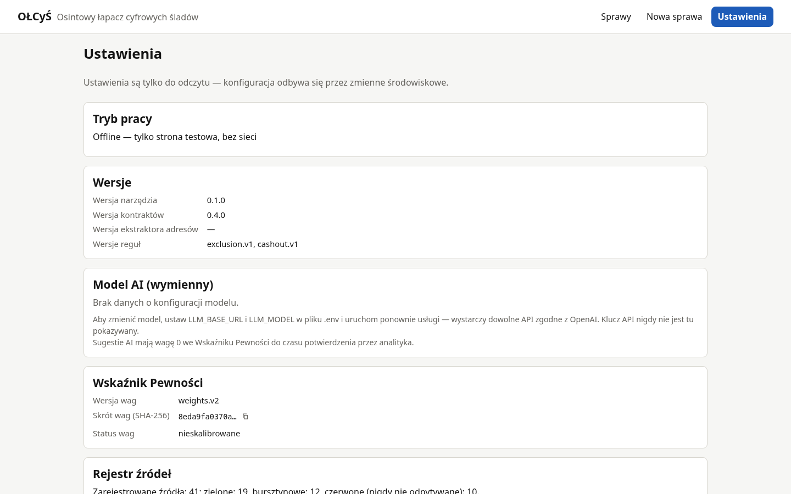

# OŁCyŚ — Osintowy łapacz cyfrowych śladów

Narzędzie OSINT dla analityków KAS. Na podstawie identyfikatorów badanej osoby (imię i nazwisko, nick, identyfikator z
komunikatora, login, e-mail, adres kryptowalutowy) wyszukuje publicznie ujawnione adresy kryptowalutowe i ocenia każde
powiązanie tożsamość↔adres Wskaźnikiem Pewności. Odrzuca błędne przypisania (giełdy, portfele powiernicze, smart
kontrakty, adresy z dokumentacji), analizuje aktywność on-chain z przesłankami wyjścia do walut tradycyjnych (fiat
cash-out) wycenionymi w PLN, powtarza analizy z porównaniem wyników i tworzy raport o wartości dowodowej. Fakty źródłowe,
wyniki obliczeń i wnioski do weryfikacji są rozdzielone w danych, API i raporcie.

**Wszystkie dane w demonstracji, testach, zrzutach ekranu i filmie są syntetyczne**: fikcyjna persona na lokalnej stronie
testowej, historia transakcji w formatach prawdziwych dostawców, ale nieistniejąca w żadnej publicznej sieci. Repozytorium
nie zawiera danych prawdziwych osób, adresów ani portfeli.

HackNation 2026, wyzwanie KAS. Zasady pracy nad kodem: [`AGENTS.md`](AGENTS.md).

## Co robi OŁCyŚ

Obowiązkowy scenariusz i odpowiadające mu funkcje:

1. **Dane wejściowe.** Sprawa ma cel, podstawę prawną i identyfikatory sześciu rodzajów (imię i nazwisko, nick,
   identyfikator z komunikatora, login społecznościowy, e-mail, adres kryptowalutowy). Identyfikator oznaczony jako
   kotwica to twierdzenie analityka, że należy do badanej osoby na danej platformie; ocena traktuje je jako udokumentowane
   założenie (P = 0,99). Zakres źródeł zamyka się przy tworzeniu sprawy.
2. **Wyszukiwanie śladów OSINT** wyłącznie w źródłach włączonych dla sprawy:
   - forum Bitcointalk (strony dla gości), Wykop, GitHub (profil, repozytoria, `FUNDING.json`), publiczny podgląd kanałów
     Telegrama, ogłoszenia P2P;
   - wyszukiwarki (lokalny mock, opcjonalnie Brave i Mojeek) i enumeracja nicków (Maigret);
   - rejestry publiczne: CEIDG, wykaz podatników VAT, KRS;
   - protokoły tożsamości: Keybase (podpisane adresy), ENS (nazwy zweryfikowane w obie strony), Farcaster
     (zweryfikowane adresy), Nostr (NIP-05) oraz archiwum BitList;
   - Wayback Machine (tylko odczyt).

   Planer rozwija wyszukiwanie z nowych kont i adresów do głębokości `maxPivotDepth`. Każda pobrana strona jest
   zabezpieczana jako dowód: adres, czas, skrót SHA-256 i manifest wzorowany na Berkeley Protocol.

3. **Wykrywanie i weryfikacja adresów.** Ekstraktor znajduje adresy (m.in. Bitcoin, EVM, TRON) w zapisanym HTML i
   sprawdza ich sumy kontrolne — o wyniku decydują sumy, nie wyrażenia regularne. Odrzuceni kandydaci (skróty transakcji,
   przykłady z dokumentacji, homoglify) są wymienieni z powodem. Klucze prywatne i frazy odzyskiwania są usuwane w pamięci
   i nigdy nie są zapisywane.
4. **Wskaźnik Pewności (0–100).** Dwuetapowy model ilorazów wiarygodności,
   `P(tożsamość↔adres) = P(tożsamość↔konto) × P(konto↔adres)`. Przesłanki są osłabiane według wiarygodności źródła
   (Admiralty Code), a niezależne ścieżki się łączą: ten sam adres w co najmniej dwóch źródłach o niezależnym pochodzeniu
   podnosi wynik, powtórzenia w jednej usłudze nie. Przedziały: 80–100 bardzo wysokie, 60–79 prawdopodobne, 40–59
   średnie, 10–39 niskie (szum), 0 wykluczenie. Każdy wynik ma listę wkładów (wykres wodospadowy), termin
   prawdopodobieństwa wg ICD 203, osobną pewność analityczną i wersje wag. Wagi są nieskalibrowane, a ocena dotyczy
   powiązania, nie osoby. Metodyka: [`docs/methodology/wskaznik-pewnosci.md`](docs/methodology/wskaznik-pewnosci.md). W demonstracji: adres w profilu forum z podpisem kryptograficznym → 99 (80–100); adres z ogłoszenia P2P potwierdzony w drugim serwisie → 77 (60–79); słaba przesłanka → 24 (10–39); adres giełdy, kontraktu lub miksera → 0. Synergia nie jest stałym dodatkiem +15 pkt: druga niezależna ścieżka mnoży szanse (ścieżki 50 i 24 dają łącznie 62), a powtórzenia w jednej usłudze nie zmieniają wyniku.
5. **Odrzucanie błędnych przypisań.** Reguły A1–A8 ([`config/rules/exclusion.v1.yaml`](config/rules/exclusion.v1.yaml)):
   etykietowane adresy usług (A1), smart kontrakty (A2: `eth_getCode` zwraca kod bajtowy ≠ `0x`, więc adres nie jest kontem osoby), adresy depozytowe giełd (A4) i lista odrzuceń z przykładami z dokumentacji i adresami burn (A8). Konta delegowane EIP-7702 (A3) nie są odrzucane, a reguły A5 (zachowanie usługi), A6 (CoinJoin) i A7 (cluster collapse) tylko oznaczają adres do weryfikacji. Odrzucenie przeklasyfikowuje adres, a nie go usuwa: przelew na adres depozytowy
   giełdy to najsilniejsza w otwartych danych przesłanka wyjścia do fiat. Panel „Odrzucone adresy” pokazuje regułę,
   uzasadnienie i pochodzenie etykiety.
6. **Aktywność on-chain i wyjście do fiat.** Wolumeny, kontrahenci, wymiany, konwersje na stablecoiny, graf przepływów
   i przesłanki B1–B7 ([`config/rules/cashout.v1.yaml`](config/rules/cashout.v1.yaml)): giełda, bramka płatnicza, karta
   krypto-fiat, wymiana na stablecoin i wyjście, P2P, przeskok między łańcuchami, nielicencjonowane lub zamknięte miejsce
   wymiany. Kwoty są wyceniane w PLN według średniego kursu NBP (tabela A) z ostatniego dnia roboczego przed transakcją i
   liczone dokładnie (`DecimalString`), bez liczb zmiennoprzecinkowych.
7. **Ponowne analizy i alerty.** Sprawa jest analizowana ponownie ręcznie lub według harmonogramu (cron w UTC), a wynik
   porównywany z poprzednim przebiegiem (dodane, usunięte i zmienione wartości oraz wyniki). Podmiana adresu portfela w
   profilu (w demonstracji BTC-1 → BTC-2) daje alert z oboma zabezpieczeniami. Panel „Oś czasu strony” łączy przebiegi z
   kopiami z Wayback Machine (oznaczonymi jako materiał strony trzeciej) i pokazuje okresy, przedziały czasu zmian oraz
   luki. Ponowna ocena (`rescore`) przelicza zapisane dowody nowymi wagami bez pobierania danych.
8. **Raport o wartości dowodowej.** Zakładka „Raport” w konsoli korzysta z tego samego modelu co HTML: blok
   odtwarzalności (wersje wag i reguł, skróty), A. Fakty źródłowe, B. Wyniki obliczeń, C. Wnioski wymagające weryfikacji,
   chronologia przepływu środków i aneks z dowodami. Pliki: podpisany PDF/A-3b z dołączonym manifestem JSON (PAdES,
   znacznik czasu RFC 3161) oraz eksporty STIX 2.1, MISP i CSV (powiązania, dowody, wyjścia do fiat, zmiany) z
   oznaczeniem TLP. Raport zaczyna się rozdziałem „Jak czytać ten raport” i podsumowaniem prostym językiem. PDF jest podpisywany, gdy działa usługa `osint-py` (profil compose `osint`); bez niej powstaje niepodpisany PDF z ostrzeżeniem. Znacznik czasu RFC 3161 jest pobierany tylko w trybie `live` (offline żądanie czeka w kolejce). Podpis w tej wersji jest demonstracyjny i niekwalifikowany (zob. „Ograniczenia i plany”).

## Założenia projektu

- Tylko źródła publiczne i legalne (OSINT); rejestr GREEN/AMBER/RED decyduje, z czym system może się łączyć.
- Wynik ocenia powiązanie tożsamość↔adres, nie osobę. System liczy, analityk decyduje; sugestie AI mają wagę zero.
- Fakty, obliczenia i wnioski są rozdzielone w danych, API i raporcie.
- Praca lokalna, bez chmury publicznej; model AI jest lokalny i wymienny.
- Każdy wynik jest odtwarzalny: wersje wag i reguł, skróty SHA-256, dziennik ruchu wychodzącego.
- Dane demonstracyjne są wyłącznie syntetyczne.

## Parametry wyszukiwania

### Zakres sprawy

Zakres zatwierdza się przy tworzeniu sprawy (`POST /api/cases`, formularz „Nowa sprawa”); serwer waliduje go funkcją
`validateCaseScope`. Po utworzeniu sprawy zakres jest widoczny, ale nie można go zmienić.

| Pole                      | Znaczenie                                                                                                                      |
| ------------------------- | ------------------------------------------------------------------------------------------------------------------------------ |
| `title`                   | tytuł sprawy                                                                                                                   |
| `purpose`, `legalBasis`   | cel i podstawa prawna (wymagane; ograniczenie celu przetwarzania)                                                              |
| identyfikatory            | `full_name`, `nickname`, `messenger_id`, `social_login`, `email`, `crypto_address`; opcjonalnie platforma i sieć (dla adresu)  |
| kotwica (`isAnchor`)      | identyfikator, który analityk uznaje za należący do badanej osoby na danej platformie; od niego zaczynają się ścieżki oceny    |
| `enabledSources`          | źródła z rejestru `config/sources.yaml` włączone dla sprawy                                                                    |
| `amberJustifications`     | uzasadnienie każdego włączonego źródła AMBER (co najmniej 20 znaków); trafia do dziennika i raportu                            |
| `chains`                  | analizowane sieci (np. `bitcoin`, `evm:1`, `tron`; lista w `packages/core/src/chains.ts`)                                      |
| `maxPivotDepth`           | ile pokoleń nowych kont i adresów planer może rozwinąć z identyfikatorów wejściowych (wartość spoza zakresu odrzuca walidacja) |
| harmonogram (opcjonalnie) | wyrażenie cron w UTC i flaga włączenia (`PUT /api/cases/:caseId/schedule`)                                                     |

### Rejestr źródeł: GREEN, AMBER, RED

[`config/sources.yaml`](config/sources.yaml) jest jedynym źródłem prawdy o zgodności źródeł i o dozwolonych hostach.
Obecnie zawiera 19 źródeł GREEN, 12 AMBER i 10 RED.

- **GREEN**: dozwolone, gdy sprawa je wymienia (np. NBP, CEIDG, KRS, wykaz VAT, Wayback, mempool.space, Keybase, ENS,
  Nostr oraz usługi lokalne: Gotenberg, podpis PDF, model AI).
- **AMBER**: domyślnie wyłączone; analityk włącza je w sprawie z uzasadnieniem (np. Bitcointalk, BitList, GitHub,
  Maigret, podgląd Telegrama, Wykop, Brave i Mojeek, Etherscan V2, TronGrid, Farcaster, publiczny RPC Solany).
- **RED**: nigdy nie są kontaktowane (np. LinkedIn, Facebook/Instagram, X, Reddit, Discord, OLX, Allegro); kod blokuje
  ich hosty także wtedy, gdy podano je jako dodatkowe.

Pełne tabele (limity zapytań, ujawnianie identyfikatora, ocena wiarygodności, regulamin, uzasadnienie) są w
[`docs/compliance/sources.md`](docs/compliance/sources.md). Generuje je
`node packages/collectors/scripts/sources-doc.ts --write`, a zgodność z rejestrem sprawdza `pnpm compliance:sources`.

### Tryby pracy i zmienne środowiskowe

| `OLCYS_MODE` | Sieć                                                                                                                                             |
| ------------ | ------------------------------------------------------------------------------------------------------------------------------------------------ |
| `offline`    | domyślny; bez internetu: strona testowa i usługi lokalne na żywo, pozostałe hosty z nagrań (`fixtures/cassettes/<zestaw>`), brak nagrania = błąd |
| `replay`     | wszystko z nagrań (także strona testowa), usługi lokalne na żywo                                                                                 |
| `live`       | prawdziwa sieć, ograniczona do hostów źródeł włączonych dla sprawy (`OLCYS_RECORD=1` nagrywa odpowiedzi)                                         |

Łańcuchy w sandboxie (regtest, Anvil; profil compose `sandbox`, źródła `sandbox_esplora` i `sandbox_anvil`) to osobny
mechanizm, a nie czwarty tryb; ich scenariusz jest planowany (zob. „Ograniczenia i plany”).

Najważniejsze zmienne z [`.env.example`](.env.example) (wartości domyślne są wyłącznie lokalne):

| Zmienna                                                                                                              | Domyślnie                                             | Znaczenie                                                                                                                      |
| -------------------------------------------------------------------------------------------------------------------- | ----------------------------------------------------- | ------------------------------------------------------------------------------------------------------------------------------ |
| `OLCYS_MODE`                                                                                                         | `offline`                                             | tryb pracy (tabela wyżej)                                                                                                      |
| `OLCYS_CASSETTE_SET`, `OLCYS_RECORD`                                                                                 | `demo-v1`, `0`                                        | zestaw nagrań i nagrywanie odpowiedzi                                                                                          |
| `OLCYS_SEARCH_MODE`                                                                                                  | `mock`                                                | `off`, `mock` (mapa witryny testowej) albo `external` (Brave i Mojeek; tylko `live` i `replay`, z kluczem, włączone w sprawie) |
| `OLCYS_FLOW_EXPANSION_HOPS`                                                                                          | `1`                                                   | przeskoki kontrahentów pobierane poza analizowane adresy (0 wyłącza; górny limit z `cashout.v1.yaml`)                          |
| `OLCYS_SCHEDULER_INTERVAL_SECONDS`                                                                                   | `30`                                                  | częstotliwość sprawdzania harmonogramów                                                                                        |
| `OLCYS_SCHEDULE_MIN_INTERVAL_MINUTES`                                                                                | `60`                                                  | minimalny odstęp przebiegów z harmonogramu w trybie `live` (offline i replay: 1 minuta)                                        |
| `OLCYS_REPORT_PDF`, `OLCYS_PDF_SIGNING`                                                                              | `true`, `true`                                        | renderowanie PDF/A i podpis (klucz demonstracyjny)                                                                             |
| `OLCYS_EXPORT_TLP`                                                                                                   | `amber`                                               | oznaczenie TLP eksportów (`white`, `green`, `amber`, `red`)                                                                    |
| `TSA_ENABLED`, `TSA_URL`                                                                                             | `true`, FreeTSA                                       | znakowanie czasem RFC 3161 (wychodzą tylko skróty; połączenie tylko w trybie `live`)                                           |
| `LLM_ENABLED`, `LLM_BASE_URL`, `LLM_MODEL`                                                                           | `false`, `http://localhost:2140/v3`, `qwen3.6-35b-ov` | model AI (zob. „AI”)                                                                                                           |
| `ETHERSCAN_API_KEY`, `TRONGRID_API_KEY`, `CEIDG_API_TOKEN`, `BRAVE_SEARCH_API_KEY`, `MOJEEK_API_KEY`, `GITHUB_TOKEN` | puste                                                 | klucze usług zewnętrznych, potrzebne tylko w trybie `live`                                                                     |
| `API_PORT`, `WEB_PORT`, `FIXTURE_PORT`                                                                               | `4000`, `5173`, `4100`                                | porty lokalne                                                                                                                  |
| `DO_NOT_TRACK` i pozostałe opt-outy                                                                                  | `1`                                                   | telemetria wyłączona (blok „Telemetry opt-outs” w `.env.example`)                                                              |

Wagi i progi oceny: [`config/scoring/weights.v2.yaml`](config/scoring/weights.v2.yaml) (domyślne; `weights.v1.yaml`
zostaje do porównań). Reguły odrzucania i wyjścia do fiat: [`config/rules/`](config/rules/). Dostawcy danych
łańcuchowych: [`config/chain-providers.yaml`](config/chain-providers.yaml).

## Szybki start

Wymagania: Node.js ≥ 26.13.1, pnpm 12, Docker (z `docker compose`) albo Podman (`podman compose`, zob.
[`docs/development.md`](docs/development.md)).

```bash
cp .env.example .env     # wartości domyślne są lokalne; OLCYS_MODE=offline
pnpm install
pnpm dev:deps            # PostgreSQL 19, Gotenberg 9 i strona testowa (docker compose up -d --wait)
pnpm db:migrate          # migracje (jako rola właściciela schematu)
pnpm dev                 # API :4000, worker i konsola :5173 na hoście
pnpm demo                # w drugim terminalu: cały scenariusz demo i podsumowanie po polsku
```

Polecenia pomocnicze:

```bash
pnpm dev:doctor          # diagnostyka środowiska (tylko odczyt)
pnpm seed                # sprawa demonstracyjna (idempotentna)
pnpm db:reset --yes      # USUWA lokalną bazę i tworzy ją od nowa (bez --yes odmawia; --dry-run pokazuje plan)
pnpm dev:deps:down       # zatrzymanie usług (dane zostają)
pnpm dev:fixture         # strona testowa na hoście zamiast w kontenerze (najpierw zatrzymaj kontener)
docker compose --profile osint up -d --build --wait   # serwis Python (Maigret, pyHanko); profil llm dodaje Ollamę
pnpm signing:init        # jednorazowo: klucz demonstracyjny do podpisu PDF
```

Konsola: <http://127.0.0.1:5173>. Środowisko, Podman i rozwiązywanie problemów:
[`docs/development.md`](docs/development.md).

## Demo i testy

- Prezentacja (PDF, 10 slajdów): [`docs/presentation/olcys-prezentacja.pdf`](docs/presentation/olcys-prezentacja.pdf); film: [`olcys-demo.mp4`](olcys-demo.mp4) (2:48).
- `pnpm demo` przeprowadza cały scenariusz na działającym lokalnym stosie (akceptuje tylko adresy loopback): sprawdza
  usługi, ustawia wariant `v1` strony testowej, tworzy sprawę persony, uruchamia przebieg 1, przełącza na wariant `v2`,
  uruchamia przebieg 2, czyta wyniki przez API i porównuje je z `fixtures/demo/manifest.json`. Podsumowanie po polsku
  pokazuje identyfikator sprawy, powiązania z wynikami, odrzucone adresy z regułami, przesłanki wyjścia do fiat, alert
  podmiany BTC-1 → BTC-2 oraz linki do sprawy i raportu. `pnpm demo --ci` kończy się kodem 1 i listą niezgodności, gdy
  wynik odbiega od oczekiwań.
- `pnpm test:e2e` to test akceptacyjny (Playwright, lokalny Chromium): siedem kroków scenariusza i ponowna analiza z
  alertem. Stos działa w procesach potomnych na localhost (w pamięci, bez bazy), a każde żądanie przeglądarki do hosta
  innego niż lokalny przerywa test. Test nie jest częścią `pnpm check`; `--screenshots` zapisuje zrzuty do
  `docs/assets/screenshots/`.
- `pnpm demo:video` nagrywa `olcys-demo.mp4` (do 3 minut, polskie napisy, znacznik „DANE SYNTETYCZNE”; wymaga `ffmpeg`).
  Domyślnie maskuje identyfikatory, adresy, skróty transakcji i e-maile — na wypadek danych rzeczywistych; `--no-mask`
  wyłącza maskowanie. Zrzuty i film w repozytorium są niemaskowane, bo wszystkie dane są syntetyczne.
- `pnpm check` (wymagany przed każdą zmianą): formatowanie (oxfmt), lint (oxlint), typy (TypeScript), bramki zgodności
  (licencje, obrazy, rejestr źródeł, SBOM, tabela licencji) i testy (Vitest, bez prawdziwej sieci).

## Architektura



Stos: TypeScript na Node.js 26 (type stripping, bez kompilacji), pnpm 12, Fastify, React i Vite, PostgreSQL 19,
Gotenberg 9, usługa w Pythonie (Maigret, socid-extractor, pyHanko), Vitest 5, oxlint i oxfmt. Pakiety zależą tylko od
kontraktów `@olcys/core`, a implementacje łączy `apps/worker`. Cały ruch sieciowy, także do lokalnych usług i modelu,
przechodzi przez `@olcys/http`. W tej wersji pipeline działa synchronicznie w procesie API, a konsola odpytuje o postęp
przebiegu. Szczegóły: [`docs/architecture.md`](docs/architecture.md),
[`docs/adr/0001-technology-stack.md`](docs/adr/0001-technology-stack.md).

Rozbudowa: nowe źródło to wpis w `config/sources.yaml` i kolektor w `packages/collectors`; nowa sieć to adapter portu `ChainProvider` w `packages/chain-adapters`; nowe reguły i wagi to wersjonowane pliki YAML w `config/rules/` i `config/scoring/`. Python działa tylko w `services/osint-py`, bo Maigret, socid-extractor i pyHanko (podpis PAdES) nie mają odpowiedników w Node.js.

## Zgodność i bezpieczeństwo

- **Wyłącznie OSINT.** Publiczne, legalne źródła; bez naruszania regulaminów, logowania na cudze konta, danych z
  wycieków, skanowania hostów i rotowania proxy. Źródła RED nie są kontaktowane, AMBER tylko z uzasadnieniem w sprawie.
- **Lista dozwolonych hostów i dziennik.** Każde żądanie przechodzi przez `EgressClient`: host musi należeć do
  włączonego źródła, obowiązują limity zapytań, a wpis dziennika (tylko do dopisywania) zawiera `containsIdentifier` i
  provenance envelope (URL z zamaskowanymi sekretami, czasy, status, SHA-256). Reguła lintera zabrania `fetch` i
  klientów HTTP poza `packages/http`.
- **robots.txt i bariery.** robots.txt (RFC 9309) jest sprawdzany przed każdym żądaniem strony. CAPTCHA, browser
  challenge, login wall, blokada lub limit zatrzymują zbieranie ze źródła (`captcha`, `login_wall`, `blocked`) — bez
  ponowień, rozwiązywania CAPTCHA i obchodzenia zabezpieczeń antybotowych. Strona blokady zostaje zapisana jako dowód.
- **Redakcja sekretów.** Klucze prywatne i frazy odzyskiwania są usuwane w pamięci przed zapisem; test pilnuje też, by
  repozytorium nie zawierało kluczy PEM ani tokenów.
- **Bramka licencji.** `pnpm compliance:licences` sprawdza każdą zależność npm i Pythona oraz obrazy kontenerów względem
  [`config/licenses.json`](config/licenses.json) (tylko licencje otwarte). Wynik:
  [`docs/compliance/licenses.md`](docs/compliance/licenses.md).
- **Brak telemetrii.** Opt-outy są w każdym kontenerze i w konfiguracji CI, a test pilnuje ich wartości. Aplikacja web
  nie ładuje zewnętrznych czcionek, skryptów ani CDN.
- **CSP i nagłówki.** Zbudowana konsola ma `default-src 'self'` i żadnych skryptów wbudowanych; jedyny wbudowany arkusz
  stylów (biblioteki grafu) jest dopuszczony po skrócie SHA-256 (zob. [`docs/security.md`](docs/security.md)). API
  wysyła restrykcyjne nagłówki, raport HTML nie zawiera skryptów, a kontenery są utwardzone (`cap_drop: ALL`,
  `no-new-privileges`).
- **Dziennik dostępu** (`access_log`, tylko do dopisywania: rola aplikacyjna ma wyłącznie SELECT i INSERT) rejestruje,
  kto oglądał lub eksportował którą sprawę. Dowody, oceny i łańcuch dowodowy także są dopisywane, a nie nadpisywane.
- **Konta użytkowników** i logowanie są poza zakresem tego MVP i są planowane w kolejnej wersji. Do tego czasu dostęp
  ogranicza wdrożenie: API nasłuchuje na `127.0.0.1`, a kontrola nagłówków `Host` i `Origin` chroni przed DNS rebinding
  i zapisami z innych witryn.

Szczegóły: [`docs/security.md`](docs/security.md), [`docs/compliance/`](docs/compliance/).

## AI

- **Model nigdy nie decyduje.** Może tylko podpowiadać: rolę wzmianki o adresie (prompt `address-role-classification`) i
  szkice wniosków do sekcji C raportu (`report-inference-draft`). Sugestie mają wagę zero, dopóki analityk ich nie
  potwierdzi z uzasadnieniem; do raportu trafiają tylko potwierdzone szkice, oznaczone „wspomagane AI, zatwierdzone przez
  analityka”.
- **Wymienny model.** Klient korzysta z API Chat Completions zgodnego z OpenAI, więc zmiana modelu to zmiana
  `LLM_BASE_URL` i `LLM_MODEL` w `.env`. Domyślnie lokalny OpenVINO Model Server (`http://localhost:2140/v3`,
  `qwen3.6-35b-ov`); Ollama i llama.cpp mają profile compose, vLLM działa tak samo. Model jest wyłączony, dopóki nie
  ustawisz `LLM_ENABLED=true`. `pnpm llm:check` sprawdza połączenie, listę modeli, odpowiedź ze schematem JSON i
  opóźnienie.
- **Prompty zablokowane skrótem** (`packages/llm/prompts.lock.json`): zmiana wydanego promptu wymaga nowej wersji.
  Zebrany tekst trafia do modelu tylko jako niezaufane dane między znacznikami, bez narzędzi w żądaniu. Każde wywołanie
  jest zapisywane (prompt, model, parametry, żądanie i odpowiedź).
- **Tekst z Telegrama nigdy nie trafia do modelu** (źródło ma `llmAllowed: false`). Awaria modelu nie przerywa przebiegu.

## Ograniczenia i plany

- Konta użytkowników i logowanie (role, sesje, ograniczanie prób) — w kolejnej wersji.
- Scenariusz z łańcuchami w sandboxie (regtest, Anvil) i nagrywanie odpowiedzi do cassettes (`fixtures/cassettes/` jest
  puste) są planowane; demonstracja korzysta ze strony testowej z danymi w formatach dostawców.
- Formaty prawdziwych API (Esplora, Etherscan V2, TronGrid, rejestry polskie) są odwzorowane według dokumentacji i
  sprawdzone na danych syntetycznych; przed użyciem w trybie `live` trzeba je zweryfikować na żywo.
- Podpis PDF jest demonstracyjny i niekwalifikowany (certyfikat samopodpisany), a znacznik FreeTSA nie daje domniemań
  eIDAS. Produkcja wymaga certyfikatu kwalifikowanego w HSM i kwalifikowanego znakowania czasem.
- Wagi Wskaźnika Pewności nie są skalibrowane na danych rzeczywistych; sprawdzian kalibracji działa na danych
  syntetycznych (zob. metodykę).
- Strony WWW są zapisywane bez zrzutu ekranu z przeglądarki (informacja w aneksie raportu).
- Nie ma osobnego wykrywania giveawayów i masowych komentarzy; takie przesłanki trafiają do przedziału 10–39 tylko przez model wag.
- Rodzina Zcash (adresy osłonięte) nie jest analizowana. Dane łańcuchowe obejmują Bitcoin, sieci EVM, TRON i Solanę (bez
  historii kont tokenowych SPL).
- Przebieg przerwany restartem API zostaje w stanie `running`, a kolejne terminy jego harmonogramu są pomijane.

## Zrzuty ekranu

Zrzuty i film `olcys-demo.mp4` (katalog główny repozytorium) pokazują dane syntetyczne bez maskowania.


_Lista spraw._


_Nowa sprawa: identyfikatory, kotwica, zakres źródeł GREEN/AMBER/RED, sieci i głębokość rozwijania._


_Przebieg analizy: etapy, liczniki i wynik._


_Powiązane adresy: Wskaźnik Pewności, przedział, uzasadnienie i synergia śladów._


_Odrzucone adresy: reguły A1–A8, przypisania stron trzecich i kandydaci odrzuceni przy weryfikacji._


_Aktywność on-chain i przesłanki wyjścia do fiat wycenione w PLN według kursów NBP._


_Graf powiązań: osoba, identyfikatory, konta, adresy i podmioty._


_Zmiany względem poprzedniej analizy i alert podmiany adresu portfela._


_Oś czasu strony: przebiegi i kopie archiwalne._


_Raport: fakty (A), wyniki obliczeń (B), wnioski do weryfikacji (C) i pliki ze skrótami._


_Ustawienia (tylko do odczytu): tryb, wersje, model AI, rejestr źródeł._

## Struktura repozytorium

```
apps/
  api/            API HTTP (Fastify) i planista harmonogramów
  worker/         pipeline analizy i composition root
  web/            konsola analityka (React, po polsku)
  fixture-site/   syntetyczna strona testowa z personą (warianty v1 i v2)
packages/         core, db, http, evidence, address-extractor, collectors, chain-adapters,
                  labels, analytics, scoring, reporting, llm
services/osint-py/  Maigret, socid-extractor, pyHanko (Python)
config/           rejestr źródeł, wagi, reguły, dostawcy danych, zgodność
fixtures/         dane syntetyczne: persona, korpusy, etykiety, ceny, cassettes
docs/             architektura, bezpieczeństwo, zgodność, metodyka, ADR
scripts/          demo, narzędzia deweloperskie, bramki zgodności
infra/            inicjalizacja bazy danych
```

## Licencje komponentów

Wykaz komponentów i ich licencji, generowany i sprawdzany w `pnpm check`:
[`docs/compliance/licenses.md`](docs/compliance/licenses.md).

## Licencja

Licencja projektu nie została jeszcze określona (w repozytorium nie ma pliku `LICENSE`).
