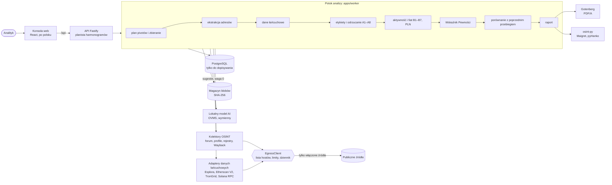
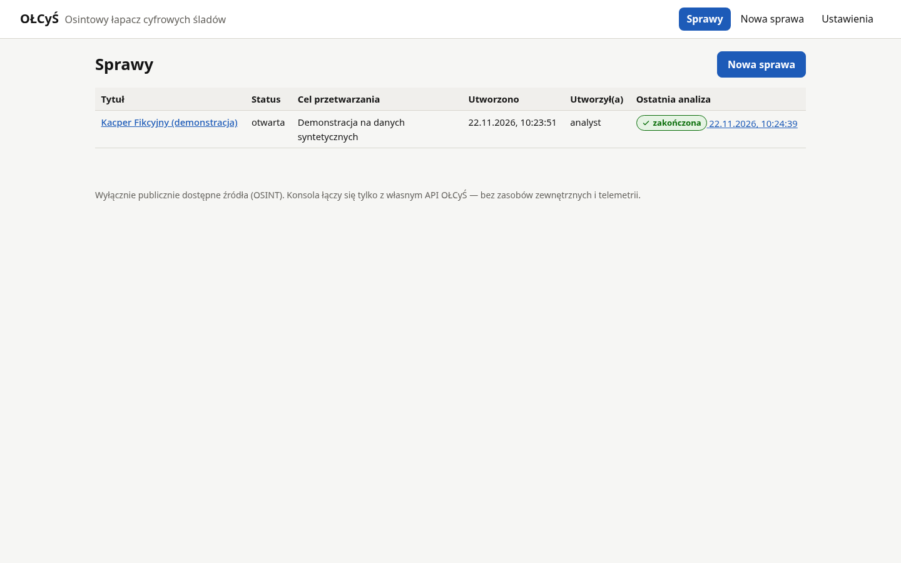
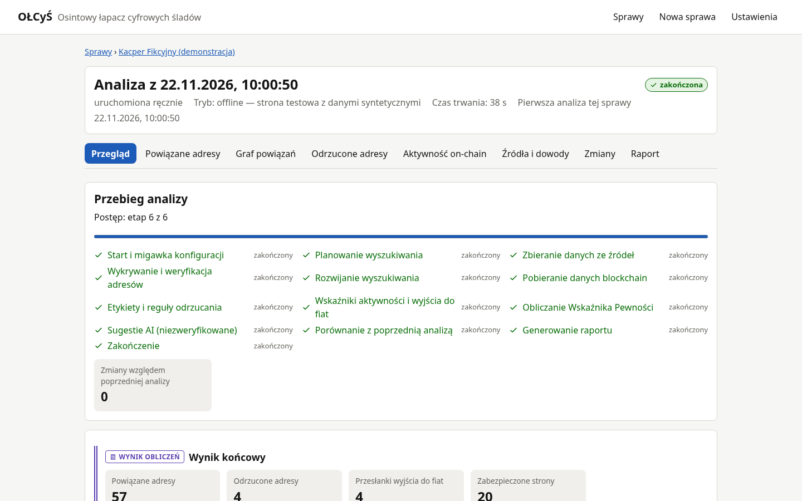
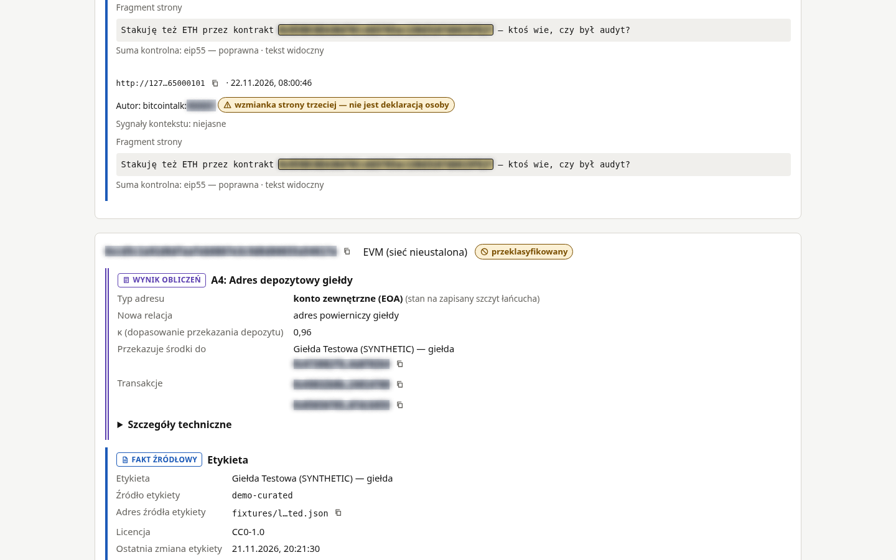
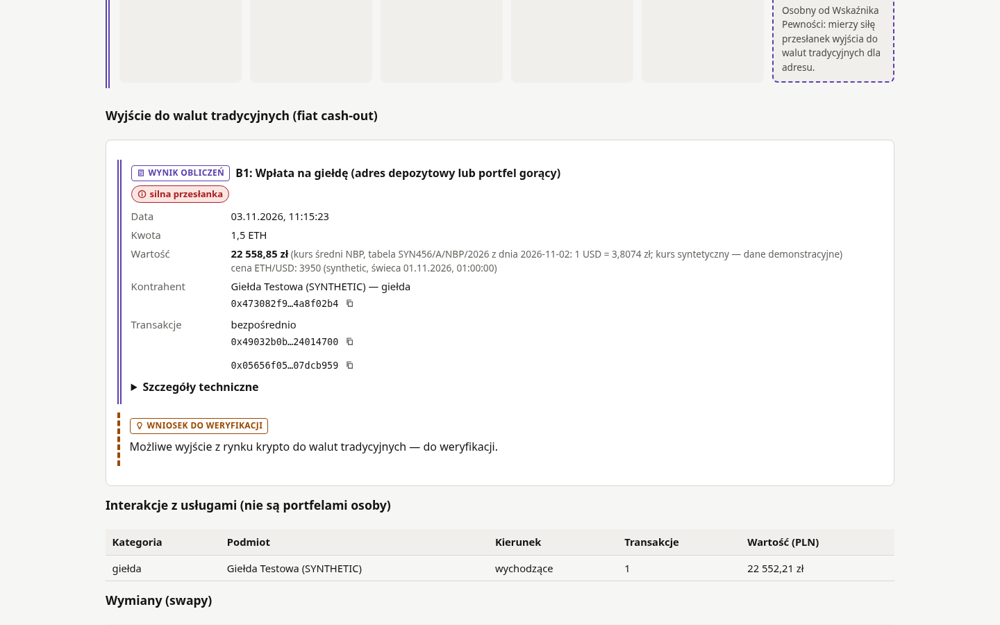
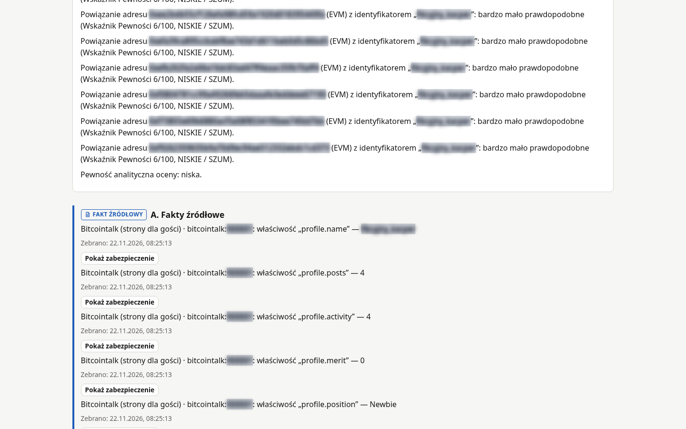

# OŁCyŚ — Osintowy łapacz cyfrowych śladów

OŁCyŚ to narzędzie OSINT dla analityków KAS. Z identyfikatorów badanej osoby (imię i nazwisko, nick, identyfikator z
komunikatora, login, e-mail, adres kryptowalutowy) wyszukuje **publicznie ujawnione adresy kryptowalutowe**, ocenia
każde powiązanie tożsamość↔adres wyjaśnialnym **Wskaźnikiem Pewności**, odrzuca błędne przypisania (giełdy, portfele
powiernicze, smart kontrakty, adresy z dokumentacji), analizuje aktywność on-chain wraz z przesłankami **wyjścia do walut
tradycyjnych (fiat cash-out)** wycenionymi w PLN, cyklicznie powtarza analizy z porównaniem wyników i tworzy raport o
wartości dowodowej. Fakty źródłowe, wyniki obliczeń i wnioski wymagające weryfikacji są w całym systemie rozdzielone.

**Wszystkie dane w demonstracji, testach, zrzutach ekranu i filmie są syntetyczne** (fikcyjna persona na lokalnej stronie
testowej; historia transakcji ma formaty prawdziwych dostawców, ale nie istnieje w żadnej publicznej sieci). Prawdziwe
osoby, adresy i portfele nie są używane ani przechowywane w repozytorium.

HackNation 2026, wyzwanie KAS. Zasady pracy nad kodem: [`AGENTS.md`](AGENTS.md).

## Co robi OŁCyŚ

Obowiązkowy scenariusz i odpowiadające mu funkcje:

1. **Dane wejściowe.** Sprawa z celem i podstawą prawną oraz sześcioma rodzajami identyfikatorów (imię i nazwisko, nick,
   identyfikator z komunikatora, login społecznościowy, e-mail, adres kryptowalutowy). Identyfikator może być
   **kotwicą**: analityk twierdzi, że należy do badanej osoby na danej platformie; wchodzi do oceny jako udokumentowane
   założenie (P = 0,99). Zakres źródeł jest zamykany przy tworzeniu sprawy.
2. **Wyszukiwanie śladów OSINT** wyłącznie w źródłach włączonych dla sprawy. Kolektory: forum Bitcointalk (strony dla
   gości), konta społecznościowe (Wykop), GitHub (profil, repozytoria, `FUNDING.json`), publiczny podgląd kanałów
   Telegrama, ogłoszenia P2P, wyszukiwarki (lokalna atrapa, opcjonalnie Brave i Mojeek), enumeracja nicków (Maigret),
   rejestry publiczne (CEIDG, wykaz podatników VAT, KRS), protokoły tożsamości (Keybase — podpisane adresy, ENS — nazwy zweryfikowane w obie strony, Farcaster — zweryfikowane adresy, Nostr — NIP-05, archiwum BitList) oraz archiwum Wayback Machine (tylko odczyt). Planer rozwija
   wyszukiwanie z nowych kont i adresów do głębokości `maxPivotDepth`. Każda pobrana strona jest zabezpieczana jako dowód:
   adres, czas, skrót SHA-256 i manifest zgodny z Protokołem Berkeley.
3. **Wykrywanie i weryfikacja adresów.** Ekstraktor wyszukuje adresy w zapisanym HTML (m.in. Bitcoin, EVM, TRON) i
   **weryfikuje sumy kontrolne**: decydują sumy, nie same wyrażenia regularne. Kandydaci odrzuceni przy weryfikacji (skróty
   transakcji, przykłady z dokumentacji, homoglify) są wymienieni z powodem. Klucze prywatne i frazy odzyskiwania są
   usuwane z pamięci i nigdy nie są zapisywane.
4. **Wskaźnik Pewności (0–100).** Dwuetapowy model ilorazów wiarygodności:
   `P(tożsamość↔adres) = P(tożsamość↔konto) × P(konto↔adres)`, z osłabianiem przesłanek według wiarygodności źródła (skala
   Admiralicji) i łączeniem niezależnych ścieżek (synergia śladów: ten sam adres w co najmniej dwóch źródłach o
   niezależnym pochodzeniu podnosi wynik, powtórzenia w jednej usłudze nie). Przedziały: **80–100 bardzo wysokie,
   60–79 prawdopodobne, 40–59 średnie, 10–39 niskie (szum), 0 wykluczenie**. Każdy wynik ma pełną listę wkładów (wykres
   wodospadowy), termin prawdopodobieństwa wg ICD 203, osobną pewność analityczną i wersje wag. Wagi są nieskalibrowane,
   a ocena opisuje powiązanie, nie osobę. Metodyka:
   [`docs/methodology/wskaznik-pewnosci.md`](docs/methodology/wskaznik-pewnosci.md).
5. **Odrzucanie błędnych przypisań.** Reguły A1–A8 ([`config/rules/exclusion.v1.yaml`](config/rules/exclusion.v1.yaml)):
   etykietowane adresy usług (A1), kontrakty usług (A2), delegowane konta EIP-7702 (A3, nie są odrzucane), adresy
   depozytowe giełd (A4), zachowanie usługi (A5), CoinJoin (A6), zapadanie się klastra (A7) oraz lista odrzuceń z
   przykładami z dokumentacji i adresami spalenia (A8). Odrzucenie **przeklasyfikowuje, a nie usuwa**: przelew na adres
   depozytowy giełdy jest najsilniejszą dostępną w otwartych danych przesłanką wyjścia do fiat. Panel „Odrzucone adresy”
   pokazuje regułę, uzasadnienie i pochodzenie etykiety.
6. **Aktywność on-chain i wyjście do fiat.** Wolumeny, kontrahenci, wymiany i konwersje na stablecoiny, graf przepływów
   oraz przesłanki B1–B7 ([`config/rules/cashout.v1.yaml`](config/rules/cashout.v1.yaml)): giełda, bramka płatnicza, karta
   krypto-fiat, wymiana na stablecoin i wyjście, P2P, przeskok między łańcuchami, nielicencjonowane lub zamknięte
   miejsce wymiany. Kwoty są wyceniane w **PLN według średniego kursu NBP (tabela A) z ostatniego dnia roboczego przed
   transakcją** i liczone dokładnie (`DecimalString`), nigdy na liczbach zmiennoprzecinkowych.
7. **Ponowne analizy, zmiany i alerty.** Ręcznie lub według harmonogramu (cron w UTC) sprawa jest analizowana ponownie, a
   wynik porównywany z poprzednim przebiegiem (dodane, usunięte, zmienione wartości i wyniki). **Podmiana adresu
   portfela w profilu** (w demonstracji BTC-1 → BTC-2) jest alertem z oboma zabezpieczeniami. Panel „Oś czasu strony”
   łączy przebiegi na żywo z kopiami z Wayback Machine (oznaczonymi jako materiał strony trzeciej), z okresami,
   przedziałami czasu zmian i lukami. Ponowna ocena (`rescore`) przelicza zapisane dowody nowymi wagami bez ponownego
   pobierania danych.
8. **Raport o wartości dowodowej.** Natywna zakładka „Raport” w konsoli (ten sam model co HTML): blok odtwarzalności
   (wersje wag i reguł, skróty), **A. Fakty źródłowe**, **B. Wyniki obliczeń**, **C. Wnioski wymagające weryfikacji**,
   chronologia przepływu środków i aneks z dowodami. Pliki: **podpisany PDF/A-3b** z dołączonym manifestem JSON (PAdES,
   znacznik czasu **RFC 3161**) oraz eksporty **STIX 2.1, MISP i CSV** (powiązania, dowody, wyjścia do fiat, zmiany) z
   oznaczeniem TLP. Podpis w tej wersji jest demonstracyjny i niekwalifikowany (zob. „Ograniczenia i plany”).

## Parametry wyszukiwania

### Zakres sprawy

Zakres jest zatwierdzany przy tworzeniu sprawy (`POST /api/cases`, formularz „Nowa sprawa”) i walidowany po stronie
serwera przez `validateCaseScope`; po utworzeniu jest widoczny, ale zablokowany.

| Pole                      | Znaczenie                                                                                                                       |
| ------------------------- | ------------------------------------------------------------------------------------------------------------------------------- |
| `title`                   | tytuł sprawy                                                                                                                    |
| `purpose`, `legalBasis`   | cel i podstawa prawna (wymagane; ograniczenie celu przetwarzania)                                                               |
| identyfikatory            | `full_name`, `nickname`, `messenger_id`, `social_login`, `email`, `crypto_address`; opcjonalnie platforma i sieć (dla adresu)   |
| kotwica (`isAnchor`)      | identyfikator, który analityk uznaje za należący do badanej osoby na danej platformie; punkt wyjścia ścieżek oceny              |
| `enabledSources`          | identyfikatory źródeł z rejestru `config/sources.yaml` włączone dla sprawy                                                      |
| `amberJustifications`     | uzasadnienie każdego włączonego źródła AMBER, **co najmniej 20 znaków**; trafia do dziennika i raportu                          |
| `chains`                  | analizowane sieci (np. `bitcoin`, `evm:1`, `tron`; lista znanych sieci w `packages/core/src/chains.ts`)                         |
| `maxPivotDepth`           | ile pokoleń nowych kont i adresów planer może rozwinąć z identyfikatorów wejściowych (wartość spoza przedziału: błąd walidacji) |
| harmonogram (opcjonalnie) | wyrażenie cron w UTC i flaga włączenia (`PUT /api/cases/:caseId/schedule`)                                                      |

### Rejestr źródeł: GREEN, AMBER, RED

[`config/sources.yaml`](config/sources.yaml) jest jedynym źródłem prawdy o zgodności źródeł i o liście dozwolonych
hostów. Obecnie: **19 źródeł GREEN, 12 AMBER i 10 RED**.

- **GREEN**: dozwolone, gdy sprawa je wymienia (np. NBP, CEIDG, KRS, wykaz VAT, Wayback, mempool.space, Keybase, ENS,
  Nostr oraz usługi lokalne: Gotenberg, podpis PDF, model AI).
- **AMBER**: wyłączone domyślnie; analityk włącza je w sprawie z uzasadnieniem (≥ 20 znaków), np. Bitcointalk, BitList,
  GitHub, Maigret, podgląd Telegrama, Wykop, Brave i Mojeek, Etherscan V2, TronGrid, Farcaster, publiczny RPC Solany.
- **RED**: nigdy nie są kontaktowane (np. LinkedIn, Facebook/Instagram, X, Reddit, Discord, OLX, Allegro); hosty RED są
  blokowane w kodzie, także jako hosty dodatkowe.

Pełne tabele (limity zapytań, czy źródło ujawnia identyfikator, ocena wiarygodności, regulamin, uzasadnienie) są
generowane z rejestru poleceniem `pnpm compliance:sources` i znajdują się w
[`docs/compliance/sources.md`](docs/compliance/sources.md).

### Tryby pracy i zmienne środowiskowe

| `OLCYS_MODE` | Sieć                                                                                                                                                 |
| ------------ | ---------------------------------------------------------------------------------------------------------------------------------------------------- |
| `offline`    | **domyślny**; bez internetu: strona testowa i usługi lokalne na żywo, pozostałe hosty z nagrań (`fixtures/cassettes/<zestaw>`), brak nagrania = błąd |
| `replay`     | wszystko z nagrań (także strona testowa), usługi lokalne na żywo                                                                                     |
| `live`       | prawdziwa sieć ograniczona do hostów źródeł włączonych dla sprawy (`OLCYS_RECORD=1` nagrywa odpowiedzi)                                              |

Łańcuchy piaskownicy (regtest, Anvil; profil compose `sandbox`, źródła `sandbox_esplora` i `sandbox_anvil`) są osobnym
mechanizmem, a nie czwartym trybem; ich scenariusz jest planowany (zob. „Ograniczenia i plany”).

Najważniejsze zmienne z [`.env.example`](.env.example) (wartości domyślne są wyłącznie lokalne):

| Zmienna                                                                                                              | Domyślnie                                             | Znaczenie                                                                                                                      |
| -------------------------------------------------------------------------------------------------------------------- | ----------------------------------------------------- | ------------------------------------------------------------------------------------------------------------------------------ |
| `OLCYS_MODE`                                                                                                         | `offline`                                             | tryb pracy (tabela wyżej)                                                                                                      |
| `OLCYS_CASSETTE_SET`, `OLCYS_RECORD`                                                                                 | `demo-v1`, `0`                                        | zestaw nagrań i nagrywanie odpowiedzi                                                                                          |
| `OLCYS_SEARCH_MODE`                                                                                                  | `mock`                                                | `off`, `mock` (mapa witryny testowej) albo `external` (Brave i Mojeek; tylko `live` i `replay`, z kluczem, włączone w sprawie) |
| `OLCYS_FLOW_EXPANSION_HOPS`                                                                                          | `1`                                                   | przeskoki kontrahentów pobierane poza analizowane adresy (0 wyłącza; górny limit z `cashout.v1.yaml`)                          |
| `OLCYS_SCHEDULER_INTERVAL_SECONDS`                                                                                   | `30`                                                  | częstotliwość sprawdzania harmonogramów                                                                                        |
| `OLCYS_SCHEDULE_MIN_INTERVAL_MINUTES`                                                                                | `60`                                                  | minimalny odstęp przebiegów z harmonogramu w trybie `live` (offline i replay: 1 minuta)                                        |
| `OLCYS_REPORT_PDF`, `OLCYS_PDF_SIGNING`                                                                              | `true`, `true`                                        | renderowanie PDF/A i podpis (klucz demonstracyjny)                                                                             |
| `OLCYS_EXPORT_TLP`                                                                                                   | `amber`                                               | oznaczenie TLP eksportów (`white`, `green`, `amber`, `red`)                                                                    |
| `TSA_ENABLED`, `TSA_URL`                                                                                             | `true`, FreeTSA                                       | znakowanie czasem RFC 3161 (poza system wychodzą tylko skróty; łączy się tylko tryb `live`)                                    |
| `LLM_ENABLED`, `LLM_BASE_URL`, `LLM_MODEL`                                                                           | `false`, `http://localhost:2140/v3`, `qwen3.6-35b-ov` | model AI (zob. „AI”)                                                                                                           |
| `ETHERSCAN_API_KEY`, `TRONGRID_API_KEY`, `CEIDG_API_TOKEN`, `BRAVE_SEARCH_API_KEY`, `MOJEEK_API_KEY`, `GITHUB_TOKEN` | puste                                                 | klucze usług zewnętrznych, potrzebne tylko w trybie `live`                                                                     |
| `API_PORT`, `WEB_PORT`, `FIXTURE_PORT`                                                                               | `4000`, `5173`, `4100`                                | porty lokalne                                                                                                                  |
| `DO_NOT_TRACK` i pozostałe opt-outy                                                                                  | `1`                                                   | telemetria wyłączona (blok „Telemetry opt-outs” w `.env.example`)                                                              |

Wagi i progi oceny: [`config/scoring/weights.v1.yaml`](config/scoring/weights.v1.yaml); reguły odrzucania i wyjścia do
fiat: [`config/rules/`](config/rules/); dostawcy danych łańcuchowych:
[`config/chain-providers.yaml`](config/chain-providers.yaml).

## Szybki start

Wymagania: **Node.js ≥ 26.13.1**, **pnpm 12**, Docker (z `docker compose`) albo Podman (`podman compose`, zob.
[`docs/development.md`](docs/development.md)).

```bash
cp .env.example .env     # wartości domyślne są lokalne; OLCYS_MODE=offline
pnpm install
pnpm dev:deps            # PostgreSQL 19, Gotenberg 9 i strona testowa (docker compose up -d --wait)
pnpm db:migrate          # migracje (jako rola właściciela schematu)
pnpm dev                 # API :4000, worker i konsola :5173 na hoście
pnpm demo                # w drugim terminalu: cały scenariusz demo i podsumowanie po polsku
```

Polecenia pomocnicze:

```bash
pnpm dev:doctor          # diagnostyka środowiska (tylko odczyt)
pnpm seed                # sprawa demonstracyjna (idempotentna)
pnpm db:reset --yes      # USUWA lokalną bazę i tworzy ją od nowa (bez --yes odmawia; --dry-run pokazuje plan)
pnpm dev:deps:down       # zatrzymanie usług (dane zostają)
pnpm dev:fixture         # strona testowa na hoście zamiast w kontenerze (najpierw zatrzymaj kontener)
docker compose --profile osint up -d --build --wait   # serwis Python (Maigret, pyHanko); profil llm dodaje Ollamę
pnpm signing:init        # jednorazowo: klucz demonstracyjny do podpisu PDF
```

Konsola: <http://127.0.0.1:5173>. Pełny opis środowiska, Podmana i rozwiązywania problemów:
[`docs/development.md`](docs/development.md).

## Demo i testy

- **`pnpm demo`** prowadzi przez cały scenariusz **działający** lokalny stos (akceptuje wyłącznie adresy pętli zwrotnej):
  kontrola zdrowia usług, wariant strony testowej `v1`, utworzenie sprawy persony, przebieg 1, przełączenie na wariant `v2`,
  przebieg 2, odczyt wyników przez API i samokontrola z `fixtures/demo/manifest.json`. Podsumowanie po polsku pokazuje
  identyfikator sprawy, powiązania z wynikami i przedziałami, odrzucone adresy z regułami, przesłanki wyjścia do fiat,
  alert podmiany BTC-1 → BTC-2 oraz adresy widoku sprawy i raportu. `pnpm demo --ci` kończy się kodem 1 i listą
  niezgodności, gdy wynik odbiega od oczekiwań.
- **`pnpm test:e2e`** to test akceptacyjny (Playwright, lokalny Chromium): prowadzi polską konsolę przez siedem kroków
  scenariusza oraz ponowną analizę z alertem, w sumie osiem kroków. Stos powstaje w procesach potomnych na pętli
  zwrotnej (pamięć zamiast bazy), a każde żądanie przeglądarki do hosta innego niż lokalny przerywa test. Nie jest częścią
  `pnpm check`. `pnpm test:e2e --screenshots` zapisuje dodatkowo zrzuty do `docs/assets/screenshots/`.
- **`pnpm demo:video`** nagrywa `olcys-demo.mp4` (do 3 minut, polskie napisy, znacznik „DANE SYNTETYCZNE”; wymaga
  `ffmpeg`). Zrzuty i film są domyślnie **maskowane**: identyfikatory persony, adresy kryptowalutowe, skróty transakcji i
  adresy e-mail są rozmywane; `--no-mask` służy wyłącznie do próby na żywo.
- **`pnpm check`** (wymagany przed każdą zmianą): formatowanie (oxfmt), lint (oxlint), typy (TypeScript), bramki zgodności
  (licencje, obrazy, rejestr źródeł, SBOM, tabela licencji) i testy (Vitest, bez dostępu do prawdziwej sieci).

## Architektura



Technologie: TypeScript na Node.js 26 (uruchamianie ze zdjęciem typów), pnpm 12, Fastify, React i Vite, PostgreSQL 19,
Gotenberg 9, usługa w Pythonie (Maigret, socid-extractor, pyHanko), Vitest 5, oxlint i oxfmt. Pakiety zależą wyłącznie od
kontraktów `@olcys/core`; implementacje łączy `apps/worker`. Cały ruch sieciowy (także do lokalnych usług i modelu)
przechodzi przez `@olcys/http`. W tej wersji potok działa synchronicznie w procesie API, a konsola odpytuje o postęp
przebiegu. Szczegóły: [`docs/architecture.md`](docs/architecture.md),
[`docs/adr/0001-technology-stack.md`](docs/adr/0001-technology-stack.md).

## Zgodność i bezpieczeństwo

- **Wyłącznie OSINT.** Publiczne, legalne źródła; bez naruszania regulaminów, logowania na cudze konta, danych z wycieków,
  skanowania hostów i rotowania proxy. Źródła RED nie są kontaktowane, AMBER tylko z uzasadnieniem w sprawie.
- **Lista dozwolonych hostów i dziennik wyjść.** Każde żądanie przechodzi przez `EgressClient`: host musi należeć do
  włączonego źródła, obowiązują limity zapytań, a wpis dziennika (tylko do dopisywania) zawiera pole
  `containsIdentifier` i kopertę pochodzenia (URL z zamaskowanymi sekretami, czasy, status, SHA-256). Reguła lintera
  zabrania `fetch` i klientów HTTP poza `packages/http`.
- **robots.txt i bariery.** robots.txt (RFC 9309) jest sprawdzany dla każdego kroku. CAPTCHA, wyzwanie przeglądarki,
  ściana logowania, blokada lub limit kończą zbieranie ze źródła (`captcha`, `login_wall`, `blocked`): **bez ponowień,
  bez rozwiązywania CAPTCHA i bez obchodzenia zabezpieczeń antybotowych**; strona blokady zostaje zapisana jako dowód.
- **Redakcja sekretów.** Klucze prywatne i frazy odzyskiwania są usuwane z pamięci przed zapisem; test pilnuje także, by
  repozytorium nie zawierało kluczy PEM ani tokenów.
- **Bramka licencji.** `pnpm compliance:licences` sprawdza każdą zależność npm i Pythona oraz obrazy kontenerów względem
  [`config/licenses.json`](config/licenses.json) (tylko licencje otwarte); wynik:
  [`docs/compliance/licenses.md`](docs/compliance/licenses.md).
- **Brak telemetrii.** Opt-outy w każdym kontenerze i konfiguracji CI, a test pilnuje ich obecności. Brak zewnętrznych
  czcionek, skryptów i CDN w aplikacji web.
- **Ścisła polityka CSP** w zbudowanej konsoli (`default-src 'self'`, bez skryptów i stylów wbudowanych), restrykcyjne
  nagłówki API, raport HTML bez skryptów, utwardzone kontenery (`cap_drop: ALL`, `no-new-privileges`).
- **Dziennik dostępu** (`access_log`, tylko do dopisywania: rola aplikacyjna ma wyłącznie SELECT i INSERT) rejestruje, kto
  oglądał lub eksportował którą sprawę. Dowody, oceny i łańcuch dowodowy są również dopisywane, a nie nadpisywane.
- **Konta użytkowników i logowanie.** **Konta użytkowników i logowanie są poza zakresem tego MVP i są planowane w kolejnej
  wersji.** Do tego czasu dostęp ogranicza się na poziomie wdrożenia: API nasłuchuje na `127.0.0.1`, a kontrola
  nagłówków `Host` i `Origin` chroni przed DNS rebinding i zapisami z innych witryn.

Szczegóły: [`docs/security.md`](docs/security.md), [`docs/compliance/`](docs/compliance/).

## AI

- **Model nigdy nie decyduje.** Może jedynie podpowiadać (rola wzmianki o adresie, odmiana polskich imion i nazwisk, szkice
  wniosków do sekcji C raportu). Sugestie mają **wagę zero w ocenie**, dopóki analityk nie potwierdzi ich decyzją z
  uzasadnieniem; do raportu trafiają tylko potwierdzone szkice, oznaczone „wspomagane AI, zatwierdzone przez analityka”.
- **Wymienny model.** Klient korzysta z API Chat Completions zgodnego z OpenAI; zmiana modelu to zmiana `LLM_BASE_URL` i
  `LLM_MODEL` w `.env`. Domyślnie lokalny OpenVINO Model Server (`http://localhost:2140/v3`, `qwen3.6-35b-ov`); Ollama i
  llama.cpp mają profile compose, vLLM działa tak samo. Model jest wyłączony, dopóki nie ustawisz `LLM_ENABLED=true`.
  `pnpm llm:check` sprawdza połączenie, listę modeli, odpowiedź ze schematem JSON i opóźnienie.
- **Prompty zablokowane skrótem** (`packages/llm/prompts.lock.json`): zmiana wydanego promptu wymaga nowej wersji.
  Zebrany tekst trafia do modelu wyłącznie jako niezaufane dane między znacznikami, a żądanie nie zawiera narzędzi.
  Każde wywołanie jest zapisywane (prompt, model, parametry, żądanie i odpowiedź).
- **Tekst z Telegrama nigdy nie jest wysyłany do modelu** (źródło z `llmAllowed: false`). Awaria modelu nie przerywa
  przebiegu.

## Ograniczenia i plany

- **Konta użytkowników i logowanie** (role, sesje, ograniczanie prób) są planowane w kolejnej wersji.
- **Scenariusz z łańcuchami piaskownicy** (regtest, Anvil) i **nagrywanie kaset** odpowiedzi (`fixtures/cassettes/` jest
  puste) są planowane; demonstracja korzysta ze strony testowej serwującej dane w formatach dostawców.
- **Formaty prawdziwych API** (Esplora, Etherscan V2, TronGrid, rejestry polskie) są odwzorowane według dokumentacji i
  sprawdzone na danych syntetycznych; przed użyciem w trybie `live` wymagają weryfikacji na żywo.
- **Podpis PDF jest demonstracyjny i niekwalifikowany** (certyfikat samopodpisany); znacznik FreeTSA nie daje domniemań
  eIDAS. Zastosowanie produkcyjne wymaga certyfikatu kwalifikowanego na module HSM i kwalifikowanego znakowania czasem.
- **Wagi Wskaźnika Pewności są nieskalibrowane** na danych rzeczywistych; sprawdzian kalibracji działa na danych
  syntetycznych (zob. metodykę).
- **Przechwytywanie w przeglądarce nie jest włączone**: strony WWW są zapisywane bez zrzutu ekranu (informacja w aneksie
  raportu).
- **Rodzina Zcash** (adresy osłonięte) nie jest analizowana, a dane łańcuchowe są dostępne dla Bitcoina, sieci EVM, TRON i Solany (bez historii kont tokenowych SPL).
- Przebieg przerwany restartem API pozostaje w stanie `running`, a kolejne terminy harmonogramu są wtedy pomijane.

## Zrzuty ekranu

Zrzuty oraz film `olcys-demo.mp4` (katalog główny repozytorium) przedstawiają **zamaskowane dane syntetyczne**:
identyfikatory persony, adresy i skróty transakcji są rozmyte.


_Lista spraw._


_Nowa sprawa: identyfikatory, kotwica, zakres źródeł GREEN/AMBER/RED, sieci i głębokość rozwijania._


_Przebieg analizy: etapy, liczniki i wynik końcowy._


_Powiązane adresy: Wskaźnik Pewności, przedział, uzasadnienie i synergia śladów._


_Odrzucone adresy: reguły A1–A8, przypisania stron trzecich i dopasowania odrzucone przy weryfikacji._


_Aktywność on-chain i przesłanki wyjścia do fiat wycenione w PLN według kursów NBP._


_Graf powiązań: osoba, identyfikatory, konta, adresy i podmioty._


_Zmiany względem poprzedniej analizy i alert podmiany adresu portfela._


_Oś czasu strony: przebiegi na żywo i kopie archiwalne._


_Raport: fakty (A), wyniki obliczeń (B), wnioski do weryfikacji (C) i lista plików ze skrótami._


_Ustawienia (tylko do odczytu): tryb, wersje, model AI, rejestr źródeł._

## Struktura repozytorium

```
apps/
  api/            API HTTP (Fastify) i planista harmonogramów
  worker/         potok analizy i punkt składania zależności
  web/            konsola analityka (React, po polsku)
  fixture-site/   syntetyczna strona testowa z personą (warianty v1 i v2)
packages/         core, db, http, evidence, address-extractor, collectors, chain-adapters,
                  labels, analytics, scoring, reporting, llm
services/osint-py/  Maigret, socid-extractor, pyHanko (Python)
config/           rejestr źródeł, wagi, reguły, dostawcy danych, zgodność
fixtures/         dane syntetyczne: persona, korpusy, etykiety, ceny, kasety
docs/             architektura, bezpieczeństwo, zgodność, metodyka, ADR
scripts/          demo, narzędzia deweloperskie, bramki zgodności
infra/            inicjalizacja bazy danych
```

## Licencje komponentów

Wykaz komponentów i ich licencji (generowany, sprawdzany w `pnpm check`):
[`docs/compliance/licenses.md`](docs/compliance/licenses.md).

## Licencja

Licencja projektu nie została jeszcze określona (w repozytorium nie ma pliku `LICENSE`).
